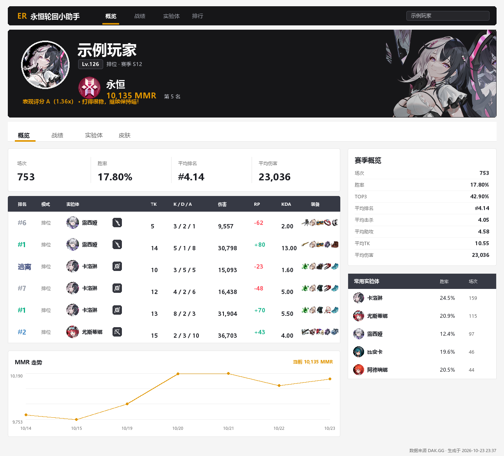
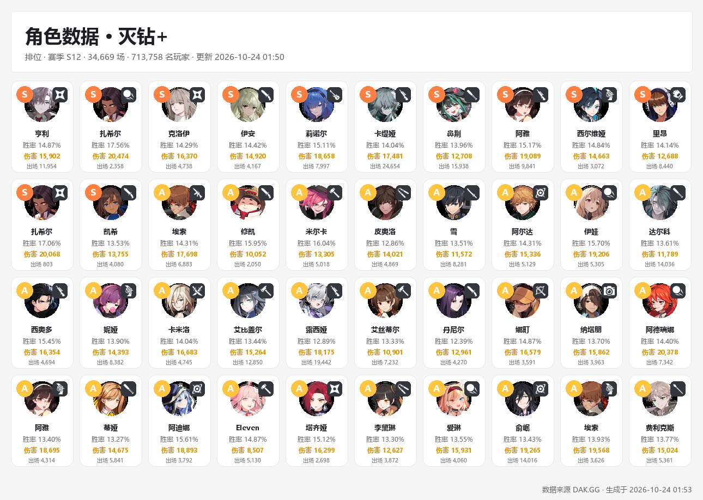
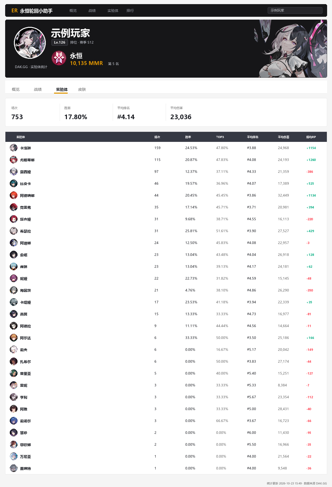
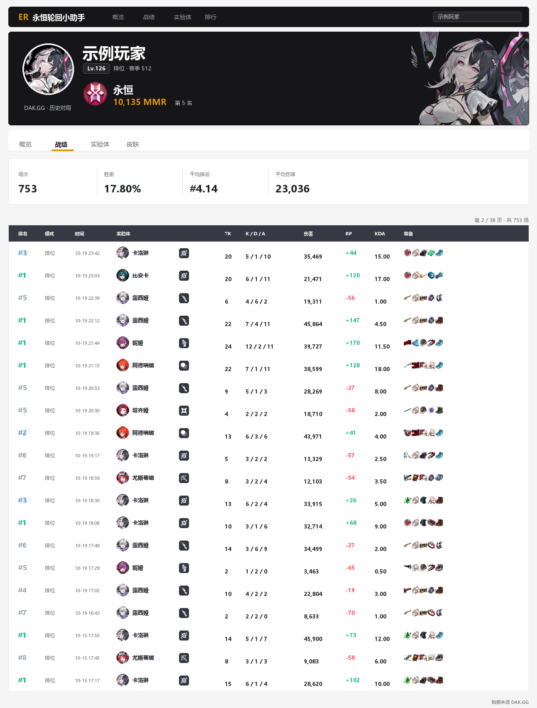
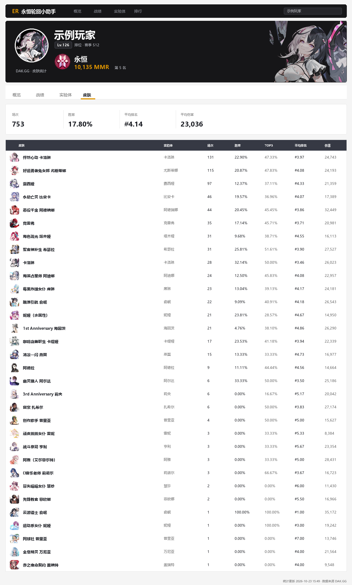

# 永恒轮回小助手

> **本项目为纯 AI 制作**，仅供学习与交流使用。如涉及图片、数据或文字侵权，请联系 QQ 邮箱 **3033980089@qq.com**，我会尽快核实并删除相关内容。

> AstrBot 插件 · 永恒轮回（Eternal Return）战绩与数据查询
> 数据来源 [DAK.GG](https://dak.gg/er)
> 这是一个全新实现的项目：功能设计上参考并致敬 [LuoRenMu/EternalReturnLoMu](https://github.com/LuoRenMu/EternalReturnLoMu)；**UI 只参考 DAK.GG 官网，不参考原项目排版**；代码与文案为独立实现，并非原项目的官方移植或分支。

## 功能

| 指令 | 说明 |
| --- | --- |
| `/查询玩家 <昵称> [模式]` | 玩家段位、MMR、胜率、场均数据、表现评分、最近对局、常用实验体、双排搭档、MMR 走势 |
| `/查询角色 <角色名> [模式]` | 角色评级、武器流派、技能加点顺序、主流出装、高分玩家 |
| `/查询实验体 <昵称> [模式]` | 个人页·全部实验体的场次、胜率、TOP3、平均排名、伤害与 RP |
| `/历史对局 <昵称> [页码] [模式]` | 个人页·历史对局，每页 20 场，可翻页 |
| `/查询皮肤 <昵称> [模式]` | 个人页·皮肤使用次数、胜率、平均排名与伤害 |
| `/角色数据 [段位]` | 排位模式下全部「角色 × 武器」的评级、胜率、出场与平均伤害 |
| `/段位统计 [服务器]` | 全服段位人数分布、永恒/半神分数线 |
| `/永恒多少分 [服务器]` | 当前赛季最高 RP 与永恒/半神分数线 |
| `/查询装备 <名称/拼音/ID>` | 装备品质、属性说明与合成材料 |
| `/绑定昵称 <昵称>` / `/解绑` / `/我的绑定` | 个人昵称绑定，绑定后 `/查询玩家` 可省略昵称 |
| `/永恒轮回帮助` | 查看全部指令 |

别名：`查玩家` / `永恒查询`、`查角色`、`实验体`、`对局记录`、`皮肤统计`、`角色排行`、`段位分布`、`分数线`、`装备查询` / `查装备`、`er帮助` / `erhelp`。

模式支持：`排位`（默认）、`匹配`、`钴协议`、`全部`。`/角色数据` 与角色详情仅支持 DAK.GG 提供统计的排位 / 匹配 / 钴协议口径；联盟、孤狼因上游未做过滤，暂不提供。
服务器支持：`亚1`（默认）/ `亚2` / `亚3` / `美1` / `欧1` / `南1`；段位分布为全服统计，服务器仅影响分数线。

## 效果示例

```
【永恒轮回】玩家战绩
示例玩家 · Lv.126 · 灭钻 8,450 MMR
赛季 S12 · 排位
━━━━━━━━━━━━━━
场次 368  胜率 16.6%  TOP3 43.5%
平均排名 #4.12  平均击杀 3.86  平均助攻 4.21
平均TK 10.37  平均伤害 21,864
表现评分 A 1.26x · 节奏抓得很准喵！
━━━━━━━━━━━━━━
最近对局（6 场）
#1 排位 席琳·圣器 6/2/8 伤害32,410 8,450(+68)
#3 排位 杰琪·双手剑 4/3/5 伤害18,620 8,382(+41)
...
```



默认「卡片」模式采用 DAK.GG 网页风格：深色页头、白色面板、深色表头、金色强调色、紧凑数据表格，并配合角色立绘、武器/装备图标与段位徽章。



### 个人页：实验体 / 历史对局 / 皮肤

卡片按 DAK.GG 官网的个人页标签组织为「概览 / 战绩 / 实验体 / 皮肤」，每个页面都有独立的指令与卡片：







## 安装

要求 AstrBot `>= 4.16,<5`（已在 4.28.2 上测试）。

### 方式一：WebUI 上传

1. 把插件目录打包为 zip（压缩包内包含 `astrbot_plugin_eternalreturn_helper/` 目录，或直接包含 `metadata.yaml`、`main.py` 等文件均可，AstrBot 会自动识别）。
2. 打开 AstrBot WebUI → 插件 → 安装插件 → 上传 zip。
3. 等待依赖安装完成，启用插件。

### 方式二：手动放置

将整个 `astrbot_plugin_eternalreturn_helper` 目录放入：

```
AstrBot/data/plugins/astrbot_plugin_eternalreturn_helper
```

重启 AstrBot，或在 WebUI 插件页点击刷新。

依赖会自动安装：`aiohttp`、`pypinyin`（拼音搜索）、`Pillow`（卡片绘制，AstrBot 通常已自带）。卡片文字使用系统中文字体（微软雅黑等），Linux 环境建议安装 Noto Sans CJK。

## 配置

在 WebUI 的插件配置页可修改以下选项：

| 配置项 | 默认值 | 说明 |
| --- | --- | --- |
| `default_matching_mode` | 排位 | 查询未指定模式时的默认值 |
| `default_rank_tier` | 灭钻 | 「角色数据」「查询角色」使用的段位口径 |
| `render_mode` | 卡片 | `卡片` / `文本` / `图片` / `自动`；卡片使用角色立绘、武器与装备图标排版，失败时自动回退 |
| `recent_matches` | 6 | 最近对局显示条数（0~10） |
| `character_rows` | 30 | 角色数据在文字与卡片中显示的行数 |
| `cooldown_seconds` | 3 | 同一会话查询冷却，防止刷屏与触发上游限流 |
| `request_timeout` | 20 | 单次请求超时（秒） |
| `cache_ttl` | 300 | 玩家数据缓存时间（秒）；角色/装备等静态数据缓存 6 小时 |
| `auto_sync` | 开启 | 查询时后台请求 DAK.GG 同步最新战绩 |
| `proxy` | 空 | 访问 DAK.GG 较慢时可填 `http://127.0.0.1:7890` 等代理 |
| `api_base` | `https://er.dakgg.io/api` | 一般无需修改 |
| `enable_binding` | 开启 | 是否允许昵称绑定 |
| `show_rating` | 开启 | 是否显示表现评分 |

## 数据与算法

- **玩家数据**：`/v1/players/{昵称}/profile`、`/v1/players/{昵称}/matches`。
- **角色数据**：`/v1/character-stats`（角色 × 武器评级、胜率、伤害）。
- **角色攻略**：抓取 `dak.gg/er/characters/{key}` 页面内嵌的 `__NEXT_DATA__`，解析技能加点、出装、高分玩家。
- **段位 / 分数线**：`/v0/statistics/tier-distribution`、`/v0/leaderboard`。
- **装备**：`/v1/data/items`。
- **表现评分**：参考原项目的 `PlayerPerformanceRater` 思路重新实现——把最近对局与同角色公开基线对比：
  - 伤害 55%、击杀参与（K+A）25%、名次 20%，各分项比值裁剪到 `[0.35, 1.80]`；
  - 综合倍率 ≥1.45 / 1.20 / 1.05 / 0.85 / 0.65 对应极佳 / 优秀 / 良好 / 平均 / 低于平均 / 较差；
  - 等级低于 50 或近期 MMR 从峰值回落超过 200 时会给出特殊评语；
  - 评语按对局 ID 稳定选取，同一份战绩不会每次变化。
- **段位映射**：铁阎、铜魂、银烙、金魄、修罗、灭钻、星陨、无瑕、半神、永恒（`63`/`66` 两个段位 ID 不连续，已在代码中单独处理）。

## 与参考项目的关系

本项目是面向 AstrBot 的全新 Python 实现，不是原 Kotlin 项目的官方移植或分支：

- 输出以 Pillow **DAK.GG 官网网页风格卡片**为主（默认）、文字与 Markdown 文转图为辅；排版只参考 DAK.GG 官网，不再参考原项目的卡片布局；
- 未实现需要大模型分类的 `/兑换码`、`/游戏活动` 新闻链路；
- 别名系统简化为**个人绑定**（`/绑定昵称`、`/解绑`、`/我的绑定`），没有群级/全局别名；
- 最近对局按所选模式请求，而原项目固定请求全部模式；
- 角色名支持模糊匹配（原名 / 英文 key / 数字 ID），比原项目更宽松；
- 时间统一转换为运行机器的本地时区显示。

## 常见问题

**查询超时 / 连接失败**
DAK.GG 在部分网络环境下访问较慢，可在插件配置中填写 `proxy`，或调大 `request_timeout`。

**提示「请求过于频繁」**
插件已对静态数据做 6 小时缓存、玩家数据做 5 分钟缓存，并带请求重试。仍被限流时请调大 `cooldown_seconds`。

**角色数据太长**
文字版与卡片都使用 `character_rows`，默认显示前 30 行；调大即可查看更多。

**图片没有发出来**
卡片由 Pillow 本地绘制，图片素材从 DAK.GG CDN 下载；失败时会自动回退文转图或文本，并在日志中记录原因。

**查不到某个昵称**
请确认昵称完整且与游戏内一致（DAK.GG 区分大小写）。ER 昵称限英文数字 3~16 位，或中日韩文字 2~8 位，不能包含空格、下划线等符号。

## 免责声明

- 本项目 **完全由 AI 生成与制作**，仅用于学习、交流与个人研究。
- 游戏数据来自 DAK.GG 公开接口；角色立绘、装备图标、段位徽章等素材版权归 Nimble Neuron、DAK.GG 及相关权利人所有。
- 如涉及侵权，请联系 QQ 邮箱 **3033980089@qq.com**，我会尽快核实并删除或调整。详见 [DISCLAIMER.md](DISCLAIMER.md)。
- 本项目与 Nimble Neuron、DAK.GG 官方无隶属或授权关系。

## 致谢与许可

- **致敬与参考**：功能设计、数据字段组织与评分思路参考了 [LuoRenMu/EternalReturnLoMu](https://github.com/LuoRenMu/EternalReturnLoMu)（原作者 LuoRenMu），感谢原项目公开的实现与文档；**UI 不参考该项目，仅参考 DAK.GG 官网。**
- 本项目为独立实现：未复制原项目的 Kotlin 代码、图片或排版资源；评分评语与交互为重新设计，UI 只参考 DAK.GG 官网。
- 卡片中的角色立绘、武器/装备图标、段位徽章来自 DAK.GG CDN，按 7 天缓存在本机临时目录。
- 所有游戏数据版权归 Nimble Neuron 与 DAK.GG 所有；本插件仅做查询展示，不存储游戏数据。
- 本插件代码采用 MIT License。

## 开发

```bash
ruff check astrbot_plugin_eternalreturn_helper
ruff format astrbot_plugin_eternalreturn_helper
```

目录结构：

```
astrbot_plugin_eternalreturn_helper/
├── main.py              # 插件入口与指令
├── metadata.yaml        # 插件元数据
├── _conf_schema.json    # WebUI 配置 Schema
├── logo.png
├── requirements.txt
├── DISCLAIMER.md        # 纯 AI 制作与侵权联系声明
├── docs/                # README 预览图
└── core/
    ├── api.py           # DAK.GG 异步客户端（缓存 / 重试 / 代理）
    ├── models.py        # 模式、段位、格式化工具
    ├── queries.py       # 查询编排与数据模型
    ├── rating.py        # 表现评分算法
    ├── formatters.py    # 文本 / Markdown 渲染
    ├── assets.py        # DAK.GG 图片下载与缓存
    └── cards.py         # DAK.GG 网页风格卡片渲染
```

